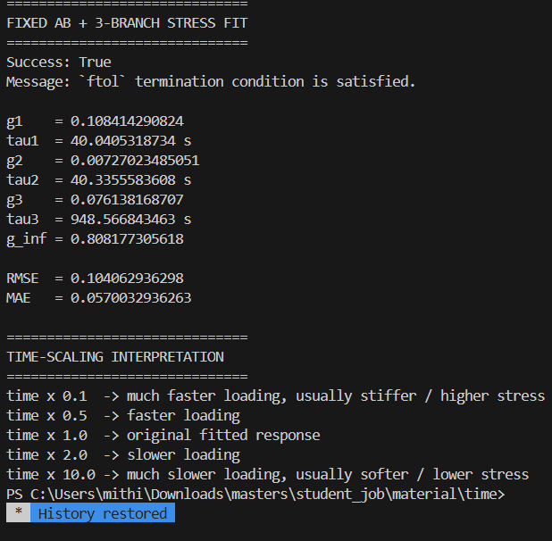
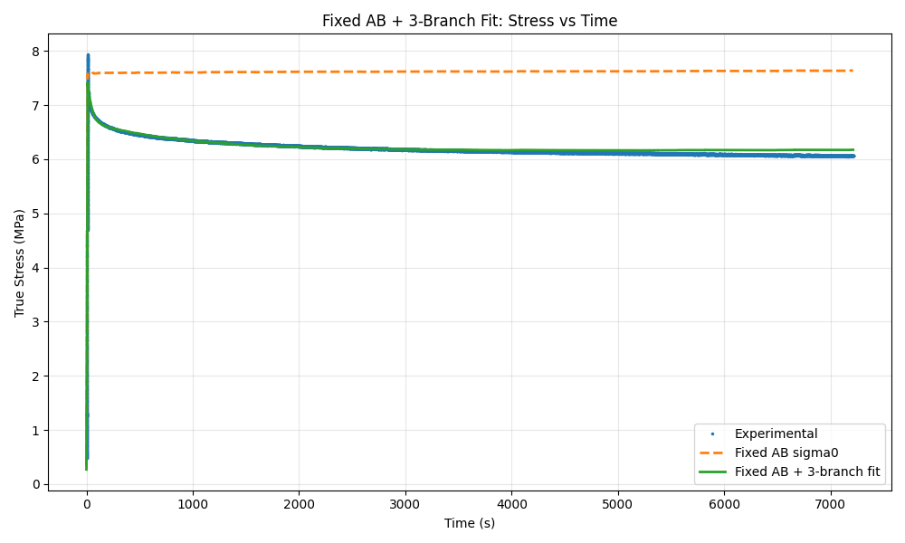
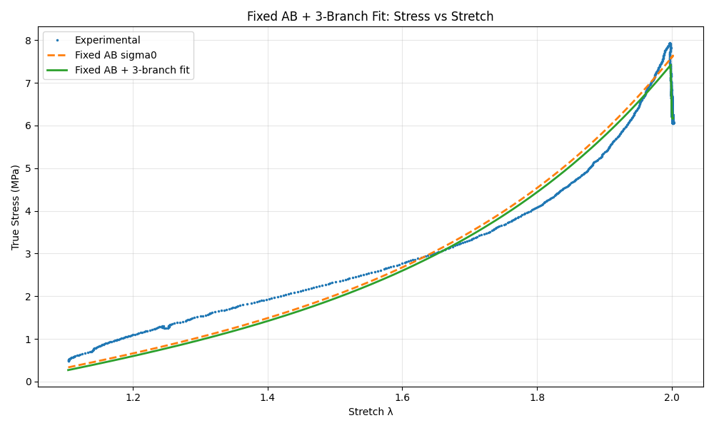
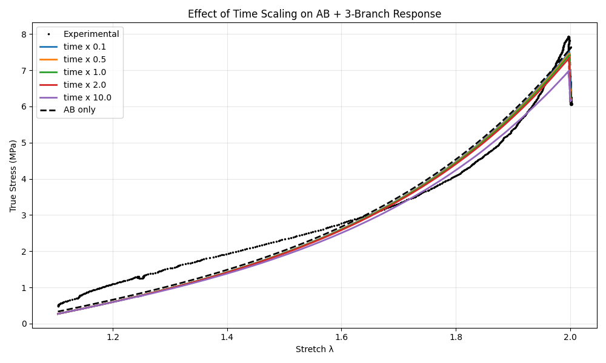
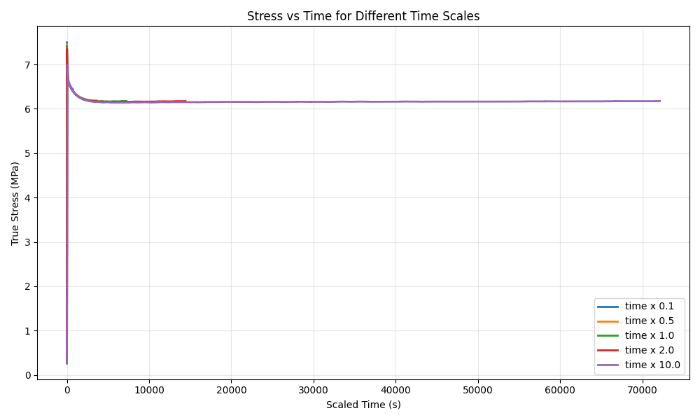

# ElastomerFit — Rate-Dependent Arruda–Boyce and Prony Viscoelasticity

Python modelling of rate-dependent rubber behaviour using a **fixed fifth-order Arruda–Boyce hyperelastic backbone**, **three Prony viscoelastic branches**, **full loading/relaxation-history fitting**, and a **time-scaling study**. The script fits six viscoelastic parameters with bounded **Trust Region Reflective (TRF) nonlinear least squares** and compares experimental true stress with the model in time and stretch coordinates.

This stage follows the hyperelastic work. Arruda–Boyce provides the nonlinear elastic response; the Prony branches introduce memory, stress relaxation and dependence on loading duration. Faster application of the same stretch history leaves less time for relaxation, while slower application generally lowers loading stresses.

The supplied code, experimental data and output images are preserved unchanged. This README is the only added project file.

## Research context and data preparation

The work is part of the elastomer-modelling workflow discussed for diaphragm-valve. Earlier separated hyperelastic calibration from subsequent viscoelastic loading/relaxation modelling, and identified the experimental sequence as **Mullins-effect removal followed by loading and a hold**. The supplied loading/relaxation CSV is used here as prepared.

The full measured stress history is fitted, including loading and the subsequent hold. This differs from a relaxation-only fit of a normalized relaxation curve. The earlier relaxation fit supplies background for the initial branch fractions; the active guesses in this uploaded script are documented below.

The fixed Arruda–Boyce values in this stage are **μ = 0.5503 and N = 1.5330**. They are the constants used in this script, not the different parameter values reported in the earlier relative-fit repository. This script does not refit the hyperelastic parameters.

## Files

| File | Contents |
|---|---|
| `main_git_timedependent_coe3_file_4.py` | Original Python code. |
| `loading_relaxation_file1.csv` | Original experimental loading and relaxation history. |
| `Figure_1.png` | Supplied stress-versus-time fit. |
| `Figure_2.png` | Supplied stress-versus-stretch fit. |
| `Figure_3.png` | Supplied time-scaling comparison versus stretch. |
| `Figure_4.png` | Supplied time-scaling comparison versus scaled time. |
| `output_console.png` | Supplied numerical-output screenshot, uploaded as `image(2).png`; image bytes unchanged. |
| `README.md` | Concepts, formulas, settings, results and run instructions. |

## Experimental input

The CSV is readable in Excel and contains **7,723 observations**:

| Column | Meaning | Unit used in the script and plots |
|---|---|---|
| `time` | Experimental time | Seconds |
| `lambda` | Axial stretch λ | Dimensionless |
| `true_stress` | Experimental true/Cauchy stress | MPa |

The time range is **0–7,211.45 s** and stretch ranges from approximately **1.10384 to 2.00198**. Units above follow the script's output labels; the CSV headers themselves contain no units. The supplied values are finite and time is strictly increasing. The code explicitly raises an error if successive time values fail to increase.

The first row already has nonzero stretch and stress. The implemented initial branch state is described below; no preceding loading history is added.

## Concepts implemented

| Concept | Implementation and purpose |
|---|---|
| Hyperelastic backbone | Fifth-order Arruda–Boyce Cauchy stress evaluated for each measured stretch. |
| Fixed hyperelastic parameters | μ and N remain constant during viscoelastic fitting. |
| Prony-series relaxation | Three exponential branches with fractions gi and time constants τi. |
| Generalized-Maxwell interpretation | A non-relaxing equilibrium contribution plus three relaxing internal stresses. |
| Stress-history dependence | Each branch retains its previous stress and is driven by changes in the AB stress. |
| Exponential recursive integration | Updates branches using the actual interval between successive measurements. |
| Small-step safeguard | Uses the limiting branch factor when Δt/τ is extremely small. |
| Full-history fitting | Uses all loading and relaxation observations in one residual vector. |
| Loading/peak weighting | Emphasizes increasing-stretch samples and the final portion of those samples. |
| Floored relative residuals | Scales errors by measured stress, with a five-percent floor. |
| Bounded TRF optimization | Fits branch fractions and time constants using `scipy.optimize.least_squares`. |
| Soft sum constraint | Penalizes total branch fractions at or above 0.999999. |
| Branch sorting | Sorts fitted τ values and their paired gi values for reporting. |
| Error metrics | Reports unweighted absolute RMSE and MAE. |
| Rate study | Changes time while retaining the same stretch history and fitted parameters. |
| Output export | Writes the fitted-history CSV and time-scaling CSV when the script is run. |

This implementation is a scalar stress-history model driven by nonlinear Arruda–Boyce stress. It is not a complete three-dimensional finite-element viscoelastic material implementation. The gi and τi values stay constant across the simulated speeds.

## 1. Fixed Arruda–Boyce backbone

The incompressible uniaxial expression uses

$$I_1=\lambda^2+\frac2\lambda,\qquad S=\lambda^2-\lambda^{-1}.$$

$$a_1=\frac1{10},\quad a_2=\frac{11}{350},\quad a_3=\frac{19}{1750},\quad a_4=\frac{519}{134750}.$$

$$B=\frac12+a_1\frac{I_1}{N}+a_2\frac{I_1^2}{N^2}+a_3\frac{I_1^3}{N^3}+a_4\frac{I_1^4}{N^4}.$$

$$\sigma_0(\lambda)=2\mu SB,\qquad \mu=0.5503,\quad N=1.5330.$$

Here σ0 is the reference hyperelastic stress driving the viscoelastic calculation. The function guards its inputs with λ ≥ 1e-12 and N ≥ 1 + 1e-12. The implemented AB law depends on stretch, not loading speed; time dependence enters through the branches.

## 2. Prony-series and equilibrium interpretation

The normalized relaxation function discussed in the project is

$$g_R(t)=g_\infty+\sum_{i=1}^{3}g_i e^{-t/\tau_i},\qquad g_\infty=1-\sum_{i=1}^{3}g_i.$$

Equivalently, $g_R(t)=1-\sum_i g_i(1-e^{-t/\tau_i})$. The ideal normalized function has gR(0) = 1 and tends to g∞ at long times. This equation explains the branch interpretation; the code evaluates the stress recursion directly rather than fitting gR(t) separately.

| Parameter | Meaning |
|---|---|
| gi | Dimensionless strength/fraction of relaxing branch i. |
| τi | Characteristic relaxation time in seconds. |
| g∞ | Remaining equilibrium fraction. |
| Qi | Internal stress carried by branch i, in the stress unit. |

At fixed stretch, the hyperelastic driving stress is constant. The branch stresses decay while the equilibrium contribution remains. Small τ branches relax quickly; larger τ branches persist longer.

## 3. Combined stress and branch recurrence

The implemented total stress is

$$\sigma_n=g_\infty\sigma_{0,n}+Q_{1,n}+Q_{2,n}+Q_{3,n}.$$

For consecutive observations:

$$\Delta t_n=t_n-t_{n-1},\qquad \Delta\sigma_{0,n}=\sigma_{0,n}-\sigma_{0,n-1}.$$

For each branch, the helper computes

$$\tau_{eff,i}=\max(\tau_i,10^{-12}),\quad x_{i,n}=\frac{\Delta t_n}{\tau_{eff,i}},\quad a_{i,n}=e^{-x_{i,n}}.$$

$$b_{i,n}=g_i\frac{1-e^{-x_{i,n}}}{x_{i,n}},\qquad Q_{i,n}=a_{i,n}Q_{i,n-1}+b_{i,n}\Delta\sigma_{0,n}.$$

If |xi,n| < 1e-12, the code sets bi,n = gi, using the limit of (1 − exp(−x))/x as x tends to zero. Otherwise it directly evaluates the exponential expression.

The update retains exponentially decaying branch memory and integrates a stress increment assuming a linear change of the driving stress over that interval. Its continuous scalar interpretation is

$$\dot Q_i+\frac{Q_i}{\tau_i}=g_i\dot\sigma_0.$$

This derivative-driven relation explains this particular recurrence. During an exact hold, Δσ0 = 0, so $Q_{i,n}=a_{i,n}Q_{i,n-1}$.

### Initial state as coded

$$Q_{1,0}=Q_{2,0}=Q_{3,0}=0,\qquad \sigma_{pred,0}=g_\infty\sigma_{0,0}.$$

Although the ideal Prony function starts at unity, the implemented first prediction uses this zero-branch state. It does not initialize an instantaneous jump or reconstruct history before the first CSV row. This matters because the supplied record begins at λ > 1.

## 4. Loading detection and peak-emphasis weights

The code calculates

$$\Delta\lambda_n=\lambda_n-\lambda_{n-1},\qquad loading_n=(\Delta\lambda_n>10^{-8}),$$

with Δλ0 = 0. If there are loading indices, the peak subset is the last

$$n_{peak}=\max\left(5,\left\lfloor0.15\,n_{loading}\right\rfloor\right)$$

of those indices. For the supplied data there are **710 loading indices** and **106 peak-emphasis indices**. These are defined by the stretch-increment rule; small increases during a near-constant hold can also qualify.

$$w_n=\begin{cases}10,&\text{peak subset},\\3,&\text{loading outside peak subset},\\1,&\text{all other samples}.\end{cases}$$

The peak value overwrites the loading value; the two weights are not multiplied. The complete history remains in the fit rather than being separated into independent loading and relaxation fits.

## 5. Weighted relative residual and soft penalty

For measured stress yn:

$$d_n=\max\left(|y_n|,\;0.05\max_k|y_k|\right),\qquad r_n=\sqrt{w_n}\frac{\sigma_{pred,n}-y_n}{d_n}.$$

Thus squared residuals use weights wn, while the stress floor prevents division by zero and limits emphasis on small stresses. The floor here is **5%**, compared with **1%** in the earlier hyperelastic script. Below the floor, these are scaled residuals rather than literal percentage errors.

One additional penalty residual is appended:

$$r_{penalty}=10^3\max\left(0,\sum_{i=1}^{3}g_i-0.999999\right).$$

SciPy's default linear-loss least-squares cost is

$$C(p)=\frac12\left(\sum_n r_n^2+r_{penalty}^2\right),\qquad p=(g_1,g_2,g_3,\tau_1,\tau_2,\tau_3).$$

The penalty encourages a positive equilibrium fraction. It is a **soft penalty**, not a strict joint constraint on the sum of gi. Individual parameter bounds are enforced separately.

## 6. Fitting method, guesses and settings

**This script uses TRF** The call is `least_squares(..., method="trf", bounds=..., max_nfev=50000, verbose=2)`.SciPy uses numerical Jacobian estimation with its defaults; other solver settings and stopping tolerances are left at their defaults.

| Setting | Active value |
|---|---|
| Fixed μ | 0.5503 |
| Fixed N | 1.5330 |
| Initial g1 | 0.0828208039 |
| Initial g2 | 0.0871650399 |
| Initial g3 | 0.0692907579 |
| Initial τ1 | 0.01 s |
| Initial τ2 | 0.1 s |
| Initial τ3 | 1.0 s |
| Each gi bound | 0–0.999999 |
| Each τi bound | 1e-8–1e8 s |
| Residual floor fraction | 0.05 |
| Default/loading/peak weights | 1 / 3 / 10 |
| Penalty threshold and multiplier | 0.999999 and 1000 |
| Small-x threshold | 1e-12 |
| Solver method | Trust Region Reflective (`trf`) |
| Maximum function evaluations | 50000 |
| Solver progress verbosity | 2 |

The earlier τ guesses **1.58437879, 53.1987869761 and 1610.6328528685 s** remain visible as comments in the code. They are not active in this upload; the executable guesses are 0.01, 0.1 and 1.0 s. After fitting, the code sorts branches by increasing τ and reorders their gi values together. Sorting changes labels, not the combined stress response.

## 7. Error measures and supplied results

The displayed metrics use unweighted absolute stress errors over the entire dataset:

$$RMSE=\sqrt{\frac1m\sum_n(\sigma_{pred,n}-y_n)^2},\qquad MAE=\frac1m\sum_n|\sigma_{pred,n}-y_n|.$$

They differ from the weighted relative objective minimized by the optimizer. Their stress unit is MPa under the script's convention.

The supplied console image reports success and termination by the `ftol` condition. Values below are transcribed from that image, not newly generated fit results:

| Branch | gi | τi (s) |
|---|---:|---:|
| 1 | 0.108414290824 | 40.0405318734 |
| 2 | 0.00727023485051 | 40.3355583608 |
| 3 | 0.076138168707 | 948.566843463 |

| Quantity | Supplied result |
|---|---:|
| g∞ | 0.808177305618 |
| RMSE | 0.104062936298 |
| MAE | 0.0570032936263 |

The first two fitted time constants are close to each other. Three branches are included in the implementation; this output alone does not establish three independently distinguishable relaxation mechanisms. Solver success describes numerical termination, not validation on separate experiments.

## 8. Speed dependence through time scaling

The fitted parameters and sampled stretch sequence remain fixed. Only the timestamps change:

$$t_n^{scaled}=f\,t_n,\qquad \Delta t_n^{scaled}=f\,\Delta t_n.$$

Each scaled response is recalculated through the same branch recurrence; it is not merely a relabelled original stress curve. For a stretch change Δλ over an interval, the corresponding average stretch rate becomes

$$\frac{\Delta\lambda}{\Delta t^{scaled}}=\frac1f\frac{\Delta\lambda}{\Delta t}.$$

| Time factor f | Duration relative to original | Loading-rate interpretation |
|---|---|---|
| 0.1 | One tenth | 10 times faster |
| 0.5 | One half | 2 times faster |
| 1.0 | Same | Original fitted history |
| 2.0 | Twice | 2 times slower |
| 10.0 | Ten times | 10 times slower |

The **whole recorded history**, including the hold, is time-scaled. Thus hold duration changes too. “Speed” here means relative loading/stretch rate; no actuator velocity in mm/s is calculated. The scaled cases are model predictions from one fitted experimental history, not additional experimental validation at five speeds.

## Supplied figures

### Figure 1 — Stress versus time

Compares measured stress, fixed AB stress and the combined fit. Near constant stretch, the AB curve remains nearly constant while the Prony branches reproduce stress decay.

### Figure 2 — Stress versus stretch

Shows the loading response and stress drop during the near-constant-stretch hold. Time still determines the branch stresses even though this plot's horizontal axis is stretch.

### Figure 3 — Rate comparison versus stretch

Compares the five scaled histories with experimental data and the AB-only reference. Faster loading generally stays closer to the unrelaxed AB response; slower loading allows more relaxation.

### Figure 4 — Rate comparison versus scaled time

Uses each case's actual scaled timestamps, showing the change in total duration as well as the stress response.

